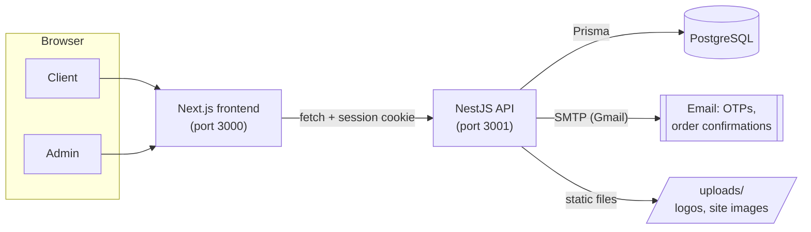
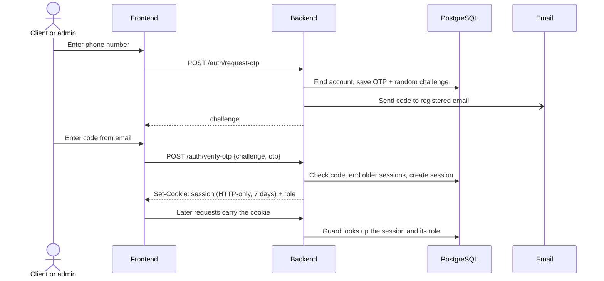

# Architecture

MeraWealth is two apps and a database:

- **Frontend**: a Next.js 16 (React 19, Tailwind CSS 4) site that clients and admins use
  in the browser.
- **Backend**: a NestJS 11 REST API that holds all business rules.
- **Database**: PostgreSQL, accessed only by the backend through Prisma 7.



The frontend renders pages and calls the API with `fetch`. It holds no secrets and no
business logic beyond input checks that the backend repeats.

## Repository layout

```
merawealth/
├── backend/                 NestJS API
│   ├── prisma/              schema.prisma and migrations
│   ├── src/
│   │   ├── auth/            register, OTP login, sessions
│   │   ├── admin/           client management + AdminGuard
│   │   ├── client/          ClientGuard
│   │   ├── company/         company listings and logos
│   │   ├── transaction/     orders and status changes
│   │   ├── order-match/     manual order matching
│   │   ├── email/           nodemailer emails
│   │   ├── tasks/           scheduled clean-up jobs
│   │   ├── prisma/          PrismaService (database client)
│   │   ├── common/          shared upload settings
│   │   └── main.ts          app start-up
│   └── uploads/             logos and site images (not in git)
├── frontend/                Next.js site
│   └── src/
│       ├── app/             pages (App Router)
│       ├── components/      page sections and pop-ups
│       └── utils/           apiFetch, order matching checks
├── docs/                    this documentation
└── docker-compose.yml       local PostgreSQL for development
```

## Backend

Each feature is a NestJS module with a **controller** (routes), a **service** (logic and
database access) and **DTOs** (request shapes, checked by `class-validator`).

| Module | Responsibility |
|---|---|
| `AuthModule` | Registration, OTP request and verification, `/auth/me`, logout, `SessionService` |
| `AdminModule` | List, view, edit and approve clients. Provides `AdminGuard` |
| `ClientModule` | Provides `ClientGuard` |
| `CompanyModule` | Company CRUD, listing status, logo upload, public company list |
| `TransactionModule` | Placing, listing, cancelling and changing the status of orders |
| `OrderMatchModule` | Manual order matching, see [order-lifecycle.md](order-lifecycle.md) |
| `EmailModule` | Sends OTP, order confirmation and admin alert emails over Gmail SMTP |
| `TasksModule` | Every 5 minutes, ends expired sessions and deletes expired OTPs |
| `PrismaModule` | Shared database client |

Start-up ([`main.ts`](../backend/src/main.ts)) adds cookie parsing, CORS for the frontend
address in `FRONTEND_URL` (with credentials), and a global `ValidationPipe` that rejects
unknown fields. Files in `backend/uploads/` are served at `/uploads/`.

### Authentication

Login is passwordless. Clients and admins sign in with their phone number and a one-time
code sent to their registered email.



- The session token is random (32 bytes) and stored server side in the `Session` table, so
  logging out or a new login ends a session immediately.
- The cookie is `httpOnly` and `sameSite=lax`, and `secure` when `NODE_ENV=production`.
- `AdminGuard` and `ClientGuard` check the cookie and the session's role on every protected
  route.
- A client can only log in once an admin has set their account to `ACTIVE`.

### Emails

[`email.service.ts`](../backend/src/email/email.service.ts) sends these emails
through Gmail SMTP, using `EMAIL_USER` and `EMAIL_APP_PASSWORD`:

- the login code,
- an "Order Received" confirmation to the client when they place an order, and
- two admin alerts from [`admin-alert.service.ts`](../backend/src/email/admin-alert.service.ts),
  sent to every admin in the `Admin` table (as BCC):
  - **New client registration**: the client's contact, KYC and bank details (account
    number masked to the last 4 digits), and how many clients are waiting for approval.
  - **New BUY / SELL order** (blue for BUY, red for SELL): the order, the client, the open
    buy and sell orders for that company, and how many orders are waiting to be verified.

Emails are sent in the background. If sending fails, the error is logged and the
registration or order still succeeds. Times are shown in India time (IST).

Order matching sends no emails.

### File uploads

Company logos are uploaded with `multipart/form-data` (field `logo`, PNG, JPEG or WebP, up
to 5 MB) and saved in `backend/uploads/company-logos/` with a unique file name. Site images
used by the frontend, such as `merawealth_logo.png` and `merawealth_banner.png`, live in
`backend/uploads/public/`. The `uploads/` folder is not in git, so copy it across when
setting up a new server.

## Frontend

Pages use the Next.js App Router. Most are client components that load data with
[`apiFetch`](../frontend/src/utils/apiFetch.ts), which sends the session cookie, sends and
parses JSON, and turns `401`/`403` into a "session ended" error so pages can redirect.

| Route | Who | What |
|---|---|---|
| `/` | Everyone | Landing banner |
| `/pre-ipo` | Everyone | Listed pre-IPO companies |
| `/bonds`, `/fdr`, `/mutual-funds` | Everyone | Information pages |
| `/about-us`, `/services`, `/process-flow` | Everyone | About the platform |
| `/disclaimer`, `/privacy-policy` | Everyone | Legal pages |
| `/register` | New client | KYC registration form |
| `/login`, `/verify-otp` | Client, admin | Passwordless login |
| `/dashboard` | Client | Trade (place BUY/SELL orders) and order history |
| `/admin` | Admin | Clients, companies, orders, View & Verify, Order Match |
| `/session-ended` | Everyone | Shown when a session expires or an account isn't active |

Main components:

| Component | Used for |
|---|---|
| `ClientDashboardCard` | Client dashboard shell |
| `TradePage` | Choosing a company and placing an order |
| `TransactionHistoryPage` | The client's orders with approved and matched quantities |
| `AdminDashboardCard` | The whole admin dashboard: clients, companies, orders |
| `OrderVerifyModal` | View & Verify pop-up for approving an order |
| `OrderMatchModal` | Order Match pop-up |
| `Header`, `Footer` | Site navigation |

## Configuration

| Variable | App | Purpose |
|---|---|---|
| `NODE_ENV` | Backend | `production` on the live server (turns on secure cookies) |
| `PORT` | Backend | API port, default 3001 |
| `DATABASE_URL` | Backend | PostgreSQL connection string |
| `FRONTEND_URL` | Backend | Allowed CORS origin, must match the browser address |
| `EMAIL_USER`, `EMAIL_APP_PASSWORD` | Backend | Gmail account and app password for emails |
| `NEXT_PUBLIC_API_URL` | Frontend | Backend address. Built into the site at `pnpm build` time |

Templates: [`backend/.env.example`](../backend/.env.example) and
[`frontend/.env.example`](../frontend/.env.example).

## Hosting

Production runs on a single AWS EC2 server: the backend, the frontend and PostgreSQL on
the same machine, with both apps kept running by [pm2](https://pm2.keymetrics.io/). The
deploy routine (backup, pull, migrate, build, restart) is in
[step-by-step.md](step-by-step.md).
