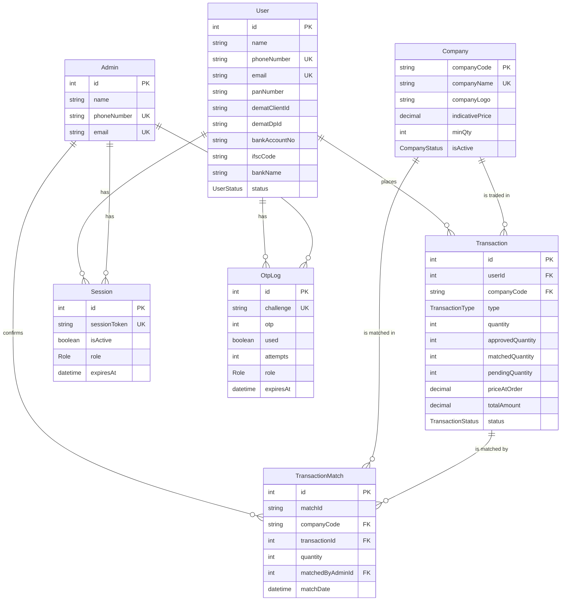

# Database

MeraWealth uses PostgreSQL through [Prisma](https://www.prisma.io/) 7. The schema lives in
[`backend/prisma/schema.prisma`](../backend/prisma/schema.prisma) and every change to it is a
migration in [`backend/prisma/migrations`](../backend/prisma/migrations).

## Diagram



## Tables

### `User`

A client. Registration stores the KYC details the platform needs to settle a deal offline:
PAN, demat account (client ID and DP ID) and bank account (number, IFSC, bank name).

`status` is `PENDING` after registration. An admin sets it to `ACTIVE` (can log in and
trade), `REJECTED` or `INACTIVE`.

### `Admin`

A platform operator. There is no sign-up screen for admins; add one directly in the
database:

```sql
INSERT INTO "Admin" (name, "phoneNumber", email, "updatedAt")
VALUES ('Your Name', '9876543210', 'you@example.com', now());
```

A phone number can't belong to both an admin and a client.

### `Company`

A pre-IPO stock that can be traded. `companyCode` (up to 8 characters) is the primary key.
`indicativePrice` is the price clients trade at and `minQty` is the smallest order allowed.
`isActive` is `ACTIVE` (listed) or `INACTIVE` (hidden). `companyLogo` is the file name of
the logo in `backend/uploads/company-logos/`.

### `Transaction`

An order. Despite the name, it records a request to buy or sell, not a completed trade.

| Column | Meaning |
|---|---|
| `type` | `BUY` or `SELL` |
| `quantity` | What the client ordered |
| `approvedQuantity` | Set by the admin on approval, 1 to `quantity` |
| `matchedQuantity` | Matched so far through Order Match |
| `pendingQuantity` | `approvedQuantity - matchedQuantity` |
| `priceAtOrder` | Company's indicative price when the order was placed |
| `totalAmount` | `priceAtOrder × quantity`, then `× approvedQuantity` once approved |
| `status` | See [order-lifecycle.md](order-lifecycle.md) |
| `adminRemarks` | Optional note |

### `TransactionMatch`

One row per order per match. Rows with the same `companyCode` and `matchId` form one
match, and their SELL quantities add up to their BUY quantities. Client, dates and price
are read from the linked order, not copied. `matchedByAdminId` records who confirmed it.

### `Session`

A login session. `sessionToken` is a random 64-character value stored in the `session`
cookie. Sessions last 7 days. A new login ends the account's other sessions, and the
`terminationReason` records why a session ended: `LOGOUT`, `NEW_LOGIN`, `EXPIRED` or `ADMIN`.

### `OtpLog`

A login code. The browser gets a random `challenge` and sends it back with the code, so
the phone number never travels with the OTP. Codes have 6 digits, expire after 5 minutes
and are marked `used` once verified. `attempts` counts wrong guesses; after 5 the code no
longer works.

`Session` and `OtpLog` belong to either a client or an admin: exactly one of `userId` and
`adminId` is set, and `role` says which.

## Rules the database enforces

Besides keys and unique columns, migrations add CHECK constraints that Prisma doesn't model:

| Constraint | Rule |
|---|---|
| `Transaction_quantities_check` | The three quantities are 0 or more, and `pendingQuantity = approvedQuantity - matchedQuantity` |
| `TransactionMatch_quantity_check` | `quantity > 0` |

## Enums

| Enum | Values |
|---|---|
| `Role` | `ADMIN`, `CLIENT` |
| `UserStatus` | `PENDING`, `ACTIVE`, `REJECTED`, `INACTIVE` |
| `CompanyStatus` | `ACTIVE`, `INACTIVE` |
| `TransactionType` | `BUY`, `SELL` |
| `TransactionStatus` | `PENDING`, `UNDER_PROCESS`, `PARTIALLY_COMPLETED`, `COMPLETED`, `REJECTED`, `CANCELLED` |
| `SessionTerminationReason` | `LOGOUT`, `NEW_LOGIN`, `EXPIRED`, `ADMIN` |

## Housekeeping jobs

[`backend/src/tasks/tasks.service.ts`](../backend/src/tasks/tasks.service.ts) runs every
5 minutes. It marks sessions past their expiry as ended (`EXPIRED`) and deletes expired OTPs.
Session rows are kept as history.

## Working with migrations

| Task | Command (in `backend/`) |
|---|---|
| Change the schema on your laptop | Edit `schema.prisma`, then `npx prisma migrate dev --name <what-changed>` |
| Apply migrations on a server | `npx prisma migrate deploy` |
| Regenerate the Prisma client | `npx prisma generate` |
| Browse the data | `npx prisma studio` |

Always back up the production database before `migrate deploy`. The steps are in
[step-by-step.md](step-by-step.md).
