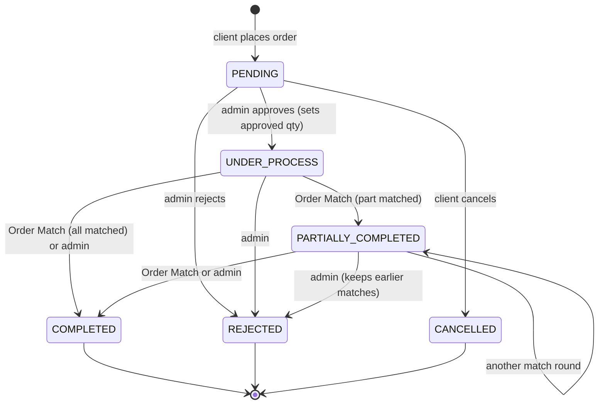

# Order lifecycle and order matching

This page explains what happens to a BUY or SELL order from the moment a client places
it until it is completed, and how admins match buyers with sellers.

## The short version

1. A client places an order at the company's **indicative price**, which the admin sets.
   The client never types a price.
2. The order starts as **PENDING**. While it is pending, the client can cancel it.
3. An admin opens the order with **View & Verify**, sets the **approved quantity**, and
   approves it. The order becomes **UNDER_PROCESS** and the client can no longer cancel it.
4. Admins use **Order Match** to pair sellers with buyers of the same company, by hand.
5. When an order has nothing left to match, it becomes **COMPLETED**. If part of it is
   matched, it becomes **PARTIALLY_COMPLETED**.
6. Money and demat transfers happen offline. The platform records the deal; it does
   not move funds or shares.

## Statuses

| Status | Meaning | Who can move it | To |
|---|---|---|---|
| `PENDING` | New order, waiting for admin review | Client, Admin | `CANCELLED` (client), `UNDER_PROCESS` or `REJECTED` (admin) |
| `UNDER_PROCESS` | Approved, waiting to be matched | Admin, Order Match | `COMPLETED`, `REJECTED`, `PARTIALLY_COMPLETED` (Order Match only) |
| `PARTIALLY_COMPLETED` | Some of the approved quantity is matched | Admin, Order Match | `COMPLETED`, `REJECTED` |
| `COMPLETED` | Fully done | Nobody | Final |
| `REJECTED` | Turned down by an admin | Nobody | Final |
| `CANCELLED` | Withdrawn by the client while pending | Nobody | Final |

These rules live in `updateTransactionStatus` in
[`backend/src/transaction/transaction.service.ts`](../backend/src/transaction/transaction.service.ts).
An admin cannot set `PARTIALLY_COMPLETED` by hand; only Order Match sets it.

Status changes are applied with a conditional update (`WHERE id = ? AND status = <the status
we read>`). If two admins, or an admin and the client, change the same order at the same
moment, only the first change wins and the other gets a `409 Conflict` asking them to refresh.

## The three quantities

Every order has the quantity the client asked for, plus three numbers the admin works with:

| Field | Set when | Meaning |
|---|---|---|
| `quantity` | Order placed | What the client ordered |
| `approvedQuantity` | Admin approves | The final quantity the platform will deal in, between 1 and `quantity` |
| `matchedQuantity` | Each Order Match confirm | How much of the approved quantity is matched so far |
| `pendingQuantity` | Approve and each confirm | What is left to match: `approvedQuantity - matchedQuantity` |

The database enforces `pendingQuantity = approvedQuantity - matchedQuantity` and that none
of them is negative, with a CHECK constraint.

On approval, the order's `totalAmount` is recalculated as `priceAtOrder × approvedQuantity`.

Orders created before order matching existed keep `approvedQuantity = 0`. They don't appear
in Order Match and are completed or rejected by hand.

## Approving an order (View & Verify)

On the admin dashboard, a PENDING order has a **View & Verify** button. It opens a pop-up
with the client, company, type, ordered quantity, price and date, and an **Approved quantity**
box filled in with the ordered quantity.

- **Approve** sends `PATCH /admin/transactions/:id` with
  `{ "status": "UNDER_PROCESS", "approvedQuantity": n }`, where `n` is between 1 and the
  ordered quantity.
- **Reject** sends `{ "status": "REJECTED" }`.

## Order matching

Matching is manual. The admin decides which seller's shares go to which buyer.

### The Order Match pop-up

The green **Order Match** button on the admin dashboard lists every company that has
approved orders with something left to match (status `UNDER_PROCESS` or
`PARTIALLY_COMPLETED`, pending above 0).

- Companies with both sellers and buyers show **Ready to match** and a **Match orders** button.
- Companies with only one side show **No buyers yet** or **No sellers yet** and a
  **View orders** button. Their screen is view only.

### The matching screen

For one company, the admin sees a **Sellers** table and a **Buyers** table. Each row shows
the order ID, date, client, price, ordered quantity, approved quantity, matched so far and
pending. The admin types two things on each row they want to match:

- **Match Qty**: how many shares of this order to match now.
- **Match ID**: a short label, for example `M1`. Rows with the same Match ID are matched
  together. One Match ID can cover one seller and many buyers, many sellers and one buyer,
  or several of each.

Two buttons:

- **Save** checks the entries in the browser and shows the pending quantity each order
  would have afterwards. Nothing is stored.
- **Confirm** sends everything to the server, which checks it again and stores it in one
  database transaction: all of it or none of it.

### Rules checked on Save and on Confirm

- Match Qty is a whole number from 1 up to the order's pending quantity.
- Every Match ID has at least one seller and at least one buyer.
- For each Match ID, the sellers' total equals the buyers' total.
- The same client can't be on both sides of a Match ID.
- A Match ID can't be reused for the same company. Match IDs are trimmed and
  upper-cased, so `m1` and `M1` are the same. Maximum 20 characters.
- If any order changed after the screen was loaded (for example someone rejected it), Confirm
  is refused with `409` and the screen reloads.

Price is not compared. Each row shows the order's price so the admin can judge.

### What Confirm stores

- One row in `TransactionMatch` per order per Match ID, with the quantity, the admin who
  confirmed it and the date.
- On each order: `matchedQuantity` goes up, `pendingQuantity` goes down, and the status
  becomes `COMPLETED` (pending is 0) or `PARTIALLY_COMPLETED` (some left). Orders not
  included stay as they were.

An order can be matched over several rounds, each with a new Match ID.

### Example

Seller S (order #103) has 20 approved shares. Buyers B1 (#101) and B2 (#102) have 10 each.

| Order | Side | Match Qty | Match ID |
|---|---|---|---|
| #103 | SELL | 20 | M1 |
| #101 | BUY | 10 | M1 |
| #102 | BUY | 10 | M1 |

Sellers total 20, buyers total 20, so Confirm stores three `TransactionMatch` rows with
`matchId = "M1"` and all three orders become `COMPLETED`.

### Safety against double matching

Confirm takes a per-company lock (`pg_advisory_xact_lock`) and locks the orders it touches
(`SELECT ... FOR UPDATE`) before it re-reads and re-checks them. Two admins confirming at the
same moment can't both use the same shares or the same Match ID.

### Code

| Part | File |
|---|---|
| Rules (pure function, unit tested) | [`backend/src/order-match/order-match.validation.ts`](../backend/src/order-match/order-match.validation.ts) |
| Endpoints | [`backend/src/order-match/order-match.controller.ts`](../backend/src/order-match/order-match.controller.ts) |
| Confirm transaction | [`backend/src/order-match/order-match.service.ts`](../backend/src/order-match/order-match.service.ts) |
| Save checks in the browser | [`frontend/src/utils/orderMatch.ts`](../frontend/src/utils/orderMatch.ts) |
| Pop-ups | [`OrderMatchModal.tsx`](../frontend/src/components/OrderMatchModal.tsx), [`OrderVerifyModal.tsx`](../frontend/src/components/OrderVerifyModal.tsx) |
